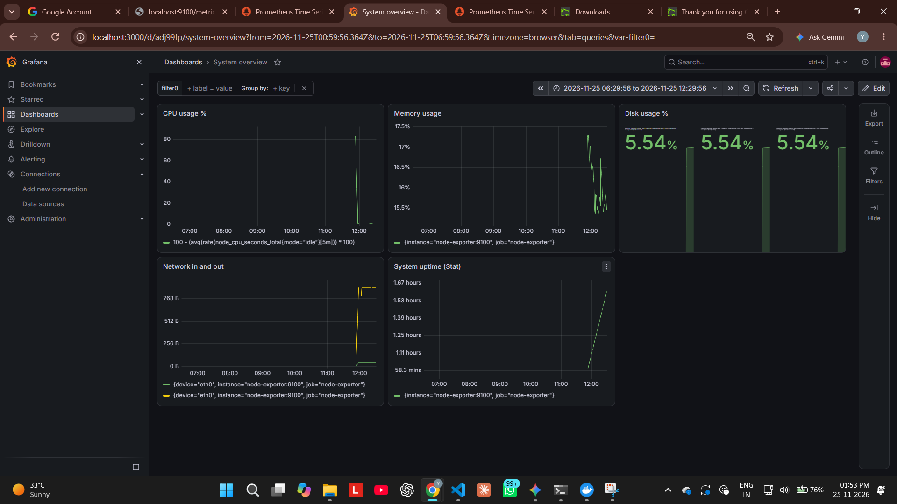

# System Monitoring Lab: Prometheus, Node Exporter & Grafana

A containerized, pull-based Linux host monitoring stack orchestrated with Docker Compose. **Prometheus** scrapes host metrics from **Node Exporter** every 15 seconds, and **Grafana** visualizes live telemetry via an auto-provisioned data source and a custom **System overview** dashboard.

## Architecture

```text
+-------------------+      HTTP GET /metrics (15s)      +-------------------+      PromQL Queries      +-------------------+
|   Node Exporter   | <-------------------------------- |    Prometheus     | <----------------------- |      Grafana      |
|   (Port 9100)     |                                   |    (Port 9090)    |                          |    (Port 3000)    |
+-------------------+                                   +-------------------+                          +-------------------+
```

* **Node Exporter (`:9100`)**: Exposes host hardware and OS metrics (CPU, memory, disk, network, uptime) at `/metrics`.
* **Prometheus (`:9090`)**: Pulls metrics on a 15-second scrape interval and stores them in its time-series database (TSDB).
* **Grafana (`:3000`)**: Connects to Prometheus via automated provisioning and renders the **System overview** dashboard.

## Repository Structure

```text
monitoring-lab/
├── docker-compose.yml
├── prometheus/
│   └── prometheus.yml
├── grafana/
│   └── provisioning/
│       └── datasources/
│           └── datasource.yml
├── dashboards/
│   └── system-overview.json
├── screenshots/
│   └── system-overview-dashboard.png
└── README.md
```

## Quick Start

### Prerequisites
* Docker & Docker Compose v2+
* Ports `3000`, `9090`, and `9100` available locally

### Run the Stack
```bash
git clone [https://github.com/Yash11071312/monitoring-lab.git](https://github.com/Yash11071312/monitoring-lab.git)
cd monitoring-lab
docker compose up -d
```

Verify all three containers are running:
```bash
docker compose ps
```

### Access the Interfaces

| Service | URL | Credentials |
| :--- | :--- | :--- |
| **Node Exporter** | `http://localhost:9100/metrics` | None |
| **Prometheus** | `http://localhost:9090/targets` | None |
| **Grafana** | `http://localhost:3000` | `admin` / `admin` |

### Import the Dashboard
1. Open Grafana at `http://localhost:3000`.
2. Go to **Dashboards → New → Import**.
3. Upload `dashboards/system-overview.json` and select the provisioned **Prometheus** data source.

## Dashboard & PromQL Queries



| Panel | Visualization | PromQL Query | Unit |
| :--- | :--- | :--- | :--- |
| **CPU usage %** | Time series | `100 - (avg(rate(node_cpu_seconds_total{mode="idle"}[5m])) * 100)` | Percent (0-100) |
| **Memory usage** | Time series | `(1 - node_memory_MemAvailable_bytes / node_memory_MemTotal_bytes) * 100` | Percent (0-100) |
| **Disk usage %** | Bar gauge | `(1 - node_filesystem_avail_bytes{fstype!~"tmpfs\|overlay"} / node_filesystem_size_bytes{fstype!~"tmpfs\|overlay"}) * 100` | Percent (0-100) |
| **Network in and out** | Time series | `rate(node_network_receive_bytes_total{device!="lo"}[5m])` & `rate(node_network_transmit_bytes_total{device!="lo"}[5m])` | bytes/sec (IEC) |
| **System uptime** | Time series / Stat | `node_time_seconds - node_boot_time_seconds` | seconds (s) |

## Verification & Testing

* **Target Failure Detection**: Stopped `node-exporter` via `docker compose stop node-exporter`, confirmed Prometheus reported the target `DOWN` (`up == 0`) with a visible gap in Grafana graphs, and restored scraping with `docker compose start node-exporter`.
* **Synthetic CPU Load Test**: Generated a 45-second CPU spike using `yes > /dev/null & PID=$!; sleep 45; kill$PID` and verified the **CPU usage %** graph reacted live before returning to baseline.